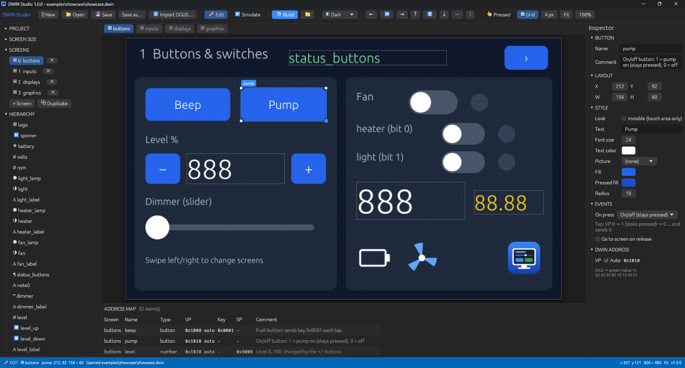
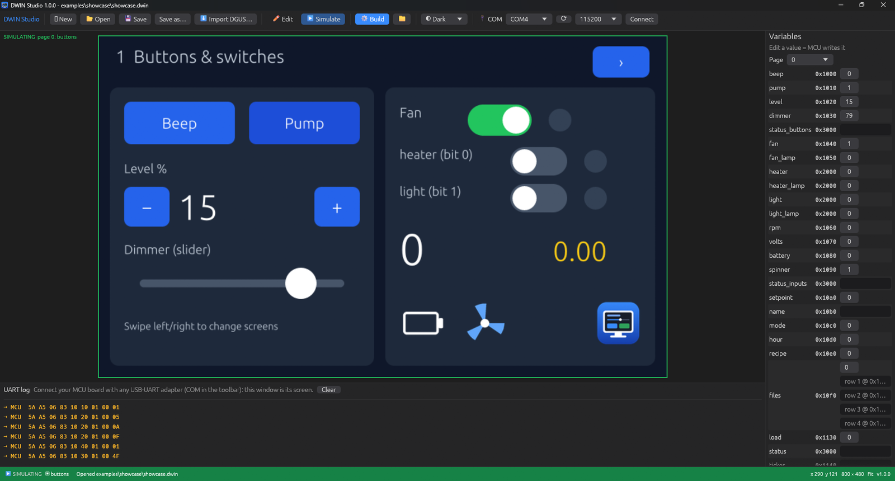
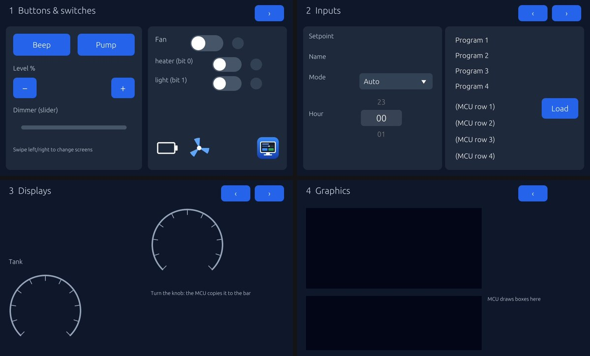
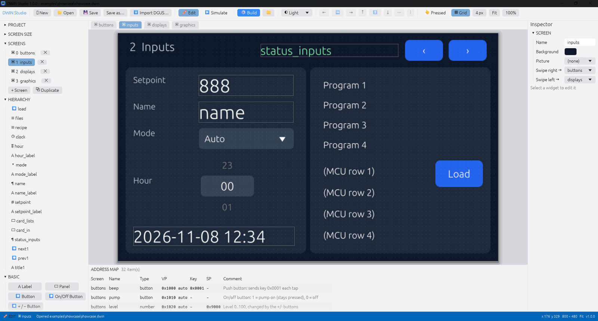

<p align="center"></p>

<h1 align="center">UWIN Studio</h1>

<p align="center">
A visual screen editor for DWIN T5L (DGUS II) displays.<br>
Design your screens, press <b>Build</b>, copy <code>DWIN_SET</code> to the SD card.<br>
It can replace DGUS V7.6.
</p>

<p align="center">by <a href="https://github.com/sudo-atharva"><b>sudo-atharva</b></a></p>



## Why

DGUS works, but it's slow to use: VP addresses typed by hand, separate tools for fonts
and icons, no way to try a screen without the hardware. UWIN Studio is one program
that does the whole job, in an editor that feels like VS Code or EEZ Studio.

## Features

- **Drag-and-drop editor:** screens, hierarchy, widget palette, inspector, undo/redo,
  multi-select, copy/paste, align/distribute, zoom and pan.
- **Smart guides:** widgets snap to each other's edges and centres (like Canva), with
  live position and size labels. Hold `Alt` to place freely.
- **One click builds everything:** `DWIN_SET` (page pictures, `.icl` icon libraries,
  `13TouchFile.bin`, `14ShowFile.bin`, `22_Config.bin`, fonts) plus:
  - `ui_map.txt`: every address, what it does, and the exact UART frames
  - `ui_gen.h`: `#define`s for your MCU code
- **Automatic VP addresses:** assigned for you, with a manual override and a comment
  for each widget. Clashes and overlaps are reported.
- **Simulator:** press **Simulate** and the screen works on the PC: buttons, keypad,
  keyboard, lists, sliders, page changes. The UART log shows every frame.
- **PC as the screen:** in the simulator, pick a COM port. Your MCU board talks to the
  PC exactly as it would to the display, so you can write firmware before the display
  arrives.
- **Import DGUS projects:** opens an existing `DWIN_SET` folder as an editable project.
- **Any screen size** (presets or custom), and configurable library numbers (page
  pictures in 23/32/42.icl, icons in 48.icl, ...).
- **Fonts:** a built-in ASCII `.HZK` font, any TTF font, and Unicode `.dzk` fonts for
  other languages (Latin, Greek, Cyrillic, Arabic, Hebrew, Indic, Thai, CJK).
- **Themes:** Dark, Light, or your own (see [Themes](#themes)).

### Widgets

| Group | Widgets |
|---|---|
| Basic | Label, Panel, Picture, Button (push / on-off latching / +- step), invisible touch areas |
| Input | Number input (keypad), Text input (keyboard), Toggle, Slider, Knob, Dropdown, List, List filled by the MCU, Roller, settable Clock |
| Display | Number, Big number (smooth), Text, Scrolling text, Unicode text, Lamp (also by bit), Icons by value, Progress (horizontal/vertical), Gauge |
| Graphics | Chart (live curve), QR code, Drawing area, Animation |

Screens can also change by swiping and with page buttons. Several toggles and lamps can share one VP, one bit each.



## Get it

**Windows:** download `UWIN-Studio-1.0.0-windows.zip` from
[Releases](../../releases), unzip it and run `UWIN Studio.exe`. Nothing to install.
`.uwin` project files open with a double-click once you've opened one through the app.

**From source** (any OS with Rust 1.85+):

```sh
git clone https://github.com/sudo-atharva/uwin-studio
cd uwin-studio
cargo run --release                      # editor
cargo run --release -- build examples/demo.uwin out   # headless build
cargo run --release -- import path/to/DWIN_SET my.uwin  # open an old DGUS project
```

## How to use it

1. **New** → pick the screen size → drag widgets from the palette onto the screen.
2. Give each widget a name and a comment. Addresses are filled in for you.
3. **Simulate** to try it. Optionally connect your MCU's COM port.
4. **Build** → copy `DWIN_SET` to the root of a FAT32 SD card → put the card in the
   display, power it on, wait for the update, remove the card, power-cycle.
5. Include `ui_gen.h` in your firmware.

The MCU side is standard DGUS II UART (115200, CRC off):

```
Screen sends on touch:  5A A5 06 83 <VP hi> <VP lo> 01 <value hi> <value lo>
MCU sets a value:       5A A5 05 82 <VP hi> <VP lo> <value hi> <value lo>
MCU switches page:      5A A5 07 82 00 84 5A 01 <page hi> <page lo>
```

## Examples

| Folder | What's in it |
|---|---|
| [`examples/showcase`](examples/showcase) | **Every widget** on 4 screens, plus an [Arduino sketch](examples/showcase/arduino/showcase/showcase.ino) that drives all of them (Mega, ESP32, Leonardo, ...). |
| [`examples/demo.uwin`](examples/demo.uwin) | A welder control panel: 3 screens. |



## Themes

Pick a theme from the **◐** menu in the toolbar. Each theme is a small JSON file in
`themes/` next to the exe. Copy one, change the colors, and it shows up in the menu.
An AI agent can make one by writing that file. The fields are documented in
`themes/README.txt`, which the app writes on first run:

```json
{
  "name": "Ocean", "dark": true,
  "accent": [0, 200, 200], "background": [12, 34, 48], "surface": [22, 60, 80],
  "field": [6, 22, 32], "text": [210, 235, 240], "canvas": [8, 26, 38],
  "status_edit": [0, 130, 140], "status_sim": [30, 150, 90]
}
```



## AI agents (MCP)

UWIN Studio has an MCP server built in. Connect it to an AI assistant, give the assistant
a flow chart and say what each button does, and it builds the screens, checks them with
screenshots, runs the build and taps through them in the simulator.

**Claude Desktop:** Settings → Developer → Edit Config, and add:

```json
{
  "mcpServers": {
    "uwin-studio": {
      "command": "C:/path/to/UWIN Studio.exe",
      "args": ["mcp"]
    }
  }
}
```

**Claude Code:**

```sh
claude mcp add -s user uwin-studio -- "C:/path/to/UWIN Studio.exe" mcp
```

`-s user` makes it available in every folder. Without it, Claude Code only sees the
server when started in the folder where you ran the command.

Any other MCP client works the same way: run `uwin-studio mcp` (JSON-RPC over stdio).

Then ask, for example:

> Make pump.uwin, 800x480. HOME: title "Pump Controller", START and STOP buttons that tell
> the MCU, a flow-rate number from the MCU, a Settings button. SETTINGS: speed setpoint
> the user types (0-100 %), Back button. Build it and test it in the simulator.

| Tools | |
|---|---|
| `new_project`, `open_project`, `get_project`, `set_project` | create, load, read, or replace a whole project |
| `widget_types` | every widget type with its properties |
| `add_screen`, `update_screen`, `remove_screen` | screens, backgrounds, swipe targets |
| `add_widget`, `update_widget`, `remove_widget` | widgets: position, size, text, colors, button actions, comments |
| `build` | writes `DWIN_SET`, `ui_map.txt`, `ui_gen.h` and returns warnings |
| `screenshot` | PNG of a screen, or of the running simulator |
| `sim_start`, `sim_tap`, `sim_drag`, `sim_type`, `sim_send`, `sim_read` | run the simulator: touch, type, MCU frames, read values |

Every edit is saved to the `.uwin` file right away. Open the file in the editor to see the
result or keep working on it by hand.

Without MCP, agents can still write `.uwin` files directly (plain JSON), build with
`uwin-studio build project.uwin out_dir` and import with `uwin-studio import DWIN_SET new.uwin`.

## Project files

A project is one `.uwin` file (files from before the rename, `.dwin`, still open). It's plain JSON, so it diffs well in git and can be
generated by scripts or AI tools. Pictures are referenced by relative path
(e.g. `assets/logo.png`).

## Status

**v1.0.0.** Tested on the author's DWIN display: the built `DWIN_SET` loads and works as
expected. Not yet tested on other DWIN models. If you try one, please open an issue
saying whether it worked.

Known limits:
- `T5LCFG.CFG` is copied from your project (or from an imported one), not generated.
- The drawing-area command format and setting the clock from the MCU follow DWIN's
  examples. Check them against your T5L manual.
- Video, camera and page-transition features from DGUS are not supported.

Tests: `cargo test`. The byte-for-byte DGUS round-trip tests run only when DWIN's sample
projects (`DWIN_Training_Demos-master`, `DWIN2_Display-main`) are in a `samples` folder next to this one.

## Branches

- `master`: stable releases. Download from here.
- `experiment`: new features and fixes being tried out. It may break; it gets merged
  into `master` once it has been tested on hardware.

## Roadmap

**Now (1.x)**
- [x] Visual editor, simulator, PC-as-screen over COM, DGUS import, themes
- [x] Tested on a DWIN T5L display
- [ ] Test on more DWIN models and sizes (help wanted: open an issue with your model)
- [ ] Generate `T5LCFG.CFG` instead of copying it
- [ ] DGUS extras: page transitions, video, camera, icon drag, parameter settings

**Next: open the `.uwin` format to other tools**
- [ ] **Export to LVGL:** turn a `.uwin` project into LVGL v9 C code (`ui.c` / `ui.h`,
      screens, styles, images, fonts) for ESP32, STM32, RP2040 and any display LVGL supports
- [ ] Export to EEZ Studio / SquareLine-style projects, and import back
- [ ] MCU library generator: typed `on_<widget>()` callbacks and `set_<widget>()` calls for
      Arduino, ESP-IDF and STM32 HAL, generated from the project (beyond `ui_gen.h`)
- [x] AI agent access (MCP server): let an AI assistant create and edit screens, build,
      and run the simulator (`experiment` branch, coming in 1.1)
- [ ] Chat inside the editor, using Claude Code if it is installed
- [ ] Web version (runs in the browser, same editor)

**Goal: DWIN replacement framework**
- [ ] Open firmware that runs `.uwin` projects on ordinary hardware (for example ESP32-S3 or
      RP2040 with any TFT and touch panel) using LVGL
- [ ] Speaks the same DGUS UART protocol (`5A A5 ... 82/83`), so an existing MCU board
      works with it unchanged: swap the DWIN display for any cheap screen
- [ ] Loads projects from SD card or over UART/USB, like `DWIN_SET` today
- [ ] One project file, three targets: real DWIN display, LVGL device, PC simulator

## Author

**[sudo-atharva](https://github.com/sudo-atharva)**: idea, design, hardware testing.

## Built with AI assistance

This project was written with an AI coding assistant:
[Claude](https://www.anthropic.com/claude) (Anthropic), used through Claude Code.
The author ([sudo-atharva](https://github.com/sudo-atharva)) designed it, tested it on real hardware and made the calls; Claude wrote
most of the code under that direction.

## License

MIT, see [LICENSE](LICENSE). Not affiliated with DWIN Technology. DWIN, DGUS and T5L
are DWIN Technology trademarks, mentioned only to describe compatibility.
